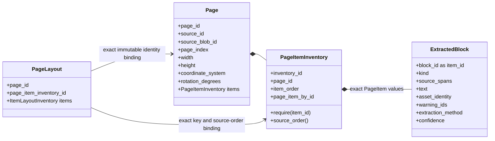
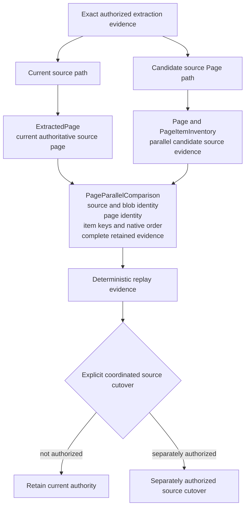
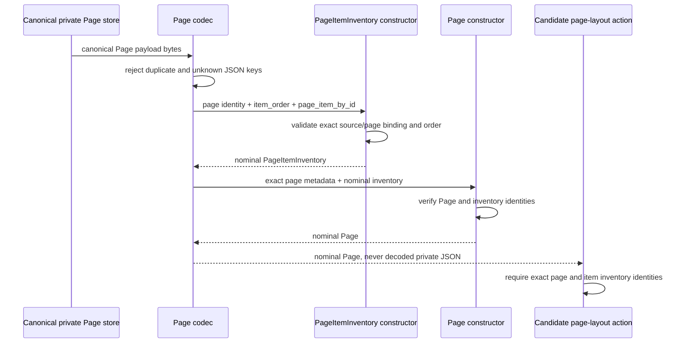
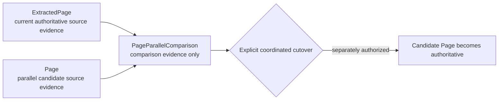

# Source Page item-map schematic

## Source ownership

`Page` owns source items. `PageLayout` owns only derived item-layout evidence.

## Parallel source build

## Candidate layout consumption

## Authority boundary

Construction, persistence, loading, comparison, and replay do not themselves
authorize source cutover or downstream layout cutover.
