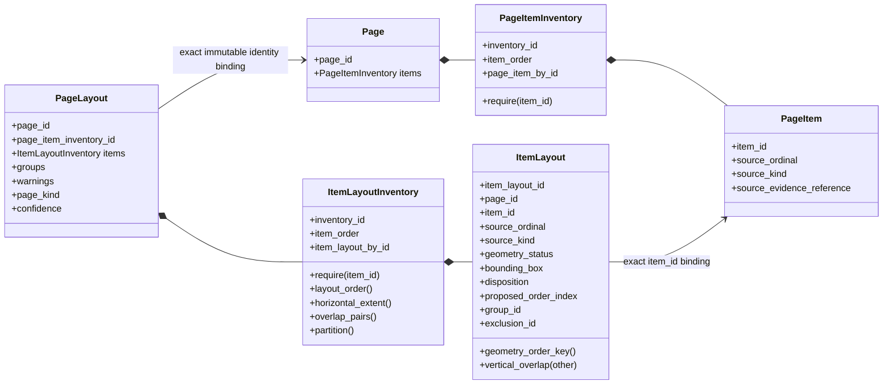
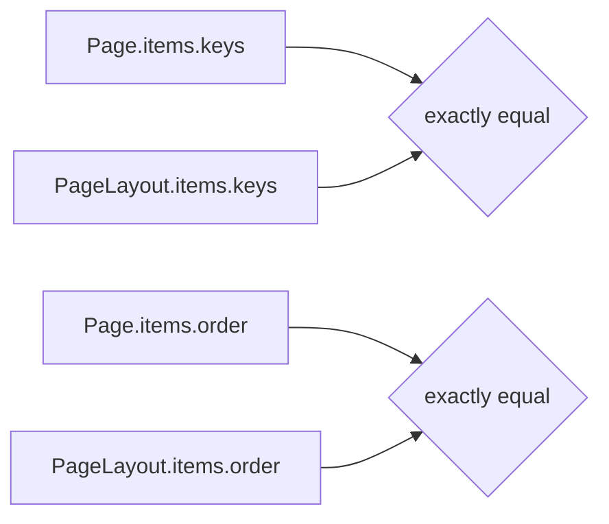
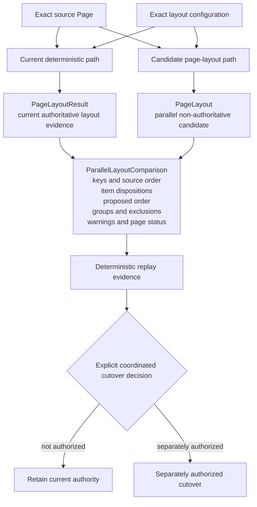
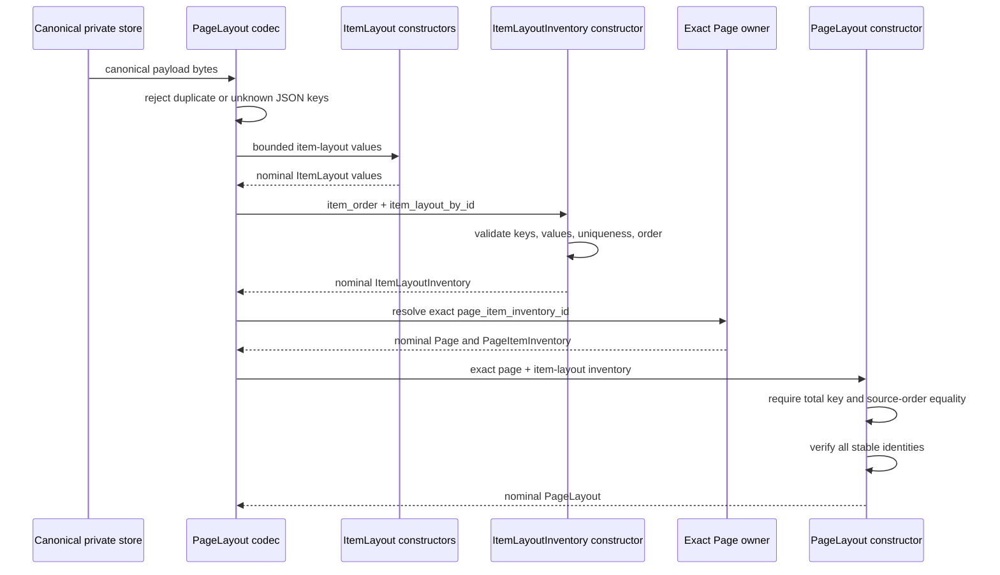
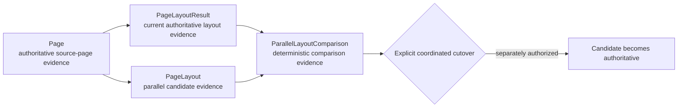

# Page-layout item-map schematic

## Semantic ownership

The constructors require exact key and source-order equality:

No module helper or empty-constructor service sits between these owners.

## Parallel build

Successful comparison and replay do not take the cutover edge automatically.

## Persistence and loading

The persisted map and order are semantic. Runtime hash buckets, hash seeds, and
capacity are not.

## Authority boundary

No design, construction, comparison, or replay edge authorizes cutover,
publication, Search admission, or release.
